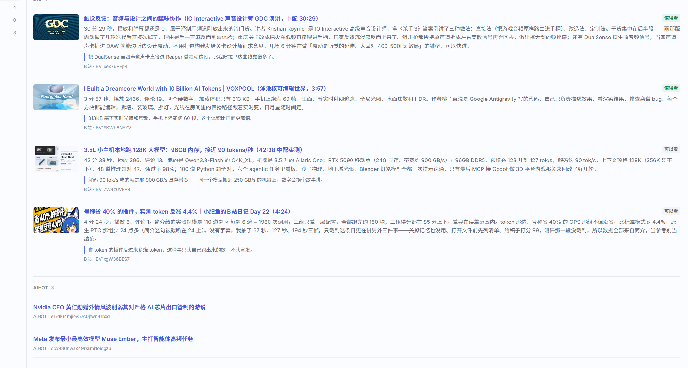

# 虫珀·蜻蛉

旧时派人采风呈报；如今每天替你巡一遍 B站、抖音和 AI 圈，把值得看的挑出来写成日报。

「蜻蛉」是旧时派出去搜集风物的人，回来把见闻呈报。这个插件干的就是这件事：一天跑一轮，只读、只挑、只写 Markdown——不建库、不做索引、不做自动互动机器人。

装好之后，侧栏多一个「蜻蛉」入口，会话顶部多一块「今天」；设置页左侧六个词（采什么 / 怎么挑 / 写到哪 / 互动 / 运行环境 / 显示）就是它的全部开关。



## 能做什么

**按时采风**

- 视频的时间点自己列：出厂三个（12:00 / 18:00 / 23:00，都在谷时），点 × 去掉、填一个新时间点「加一个时间」，最多 8 个；到点后一小时内算这一轮
- 视频一天最多跑几轮自己定（默认 3 轮），到点自己跑；想省点钱可以开「只在谷时跑」：工作日 9–12、14–18 是高峰，赶上就跳过这一轮
- AI 圈默认 12:00 跑一次；时间点可以自己加，加几个就一天跑几次，每个点各起一轮，让模型读过每条正文再写简述；抓到多少写多少，不设条数上限，也不占视频的轮数
- 也可以随时「现在就跑」，冷却照走；手动没有每日次数上限，三个源各收「手动」那一条数
- 额度按源分开算：视频每个源「每轮最多收几条」（默认 3 / 3），自动轮跑几轮就乘几；手动另有一组（默认 3 / 3 / 3）；AI 圈不设条数，到点全取
- 值班轮跑在受限 profile 里：只有 13 个采集工具，没有 bash、文件、网络、子代理
- 每一轮接着写同一条会话，直到它的上下文快装满（约 20 万 token）才另起一条 —— 不看日历，用不着你操心

**三个信源**

- B站：关键词搜索、字幕、评论、封面、收藏夹
- 抖音：浏览器桥，搜索与推荐流、截帧；登录态自己维护
- AI 圈（AIHOT）：免登录、只读，取 aihot.news 的 AI 日报 —— 单独一节，模型读过正文后写简述（说了什么 + 我的一句话），不参与视频挑档，不占视频的额度，不限条数，时间点自己加。想随时问「今天 AI 圈有什么」，直接让它看（`dragonfly_aihot`）

**挑得有理由**

- 关键词与排除词、排序方式、翻页数、人格提示词
- 每条都要写清「为什么值得」，写不出就跳过，不硬凑
- 判重表跨天去重，同一条不会第二天再报一遍

**写一份能读的日报**

- `<家目录>/out/<日期>.md`，按信源分节，带封面，含「扫过没收的」「因缺证据跳过」「私信」「总结」
- 可选单片笔记：值得的那条单独展开一份

**可选互动**

- 自动评论（带语感闸门，不像人话就不发）、回复评论、私信（只读或回复）

**看得见**

- 主区整页 + 设置页「今天」页签，同一份数据，最近 7 天可回看
- 设置页左侧六组：采什么 / 怎么挑 / 写到哪 / 互动 / 运行环境 / 显示 —— 一个词一件事，加功能只加一组

## 安装

要求：DSH 0.2.2-rc.1 及以上（已在 0.2.2-rc.3 上验过）、Node ≥ 24.9、Python 3.11+（B站采集用）。

### 本地目录（自己用推荐）

```powershell
dsh plugin --profile desktop add link:D:/dsh-workspaces/dev/虫珀/蜻蛉
```

包里有 `dsh.bundle.patch`，装上会自动进 profile 的 `dsh.profile.bundles`。装完重启宿主，设置页里就有「蜻蛉」。

### npm（换机器 / 给别人装）

```powershell
dsh plugin --profile desktop add @zhuifengqug/dsh-dragonfly
```

已发布到 npm，当前版本 `0.1.6`：[npmjs.com/package/@zhuifengqug/dsh-dragonfly](https://www.npmjs.com/package/@zhuifengqug/dsh-dragonfly)。要锁版本就写全 `@zhuifengqug/dsh-dragonfly@0.1.6`；升级时把版本号换成新的，再执行一次同样的命令。

### 模型用哪一个

设置页「运行环境 → 模型」里能选到你在桌面端加过的**所有** provider —— 值班轮每跑一次都会把桌面 profile 里的模型清单原样带过去，你在桌面加一个新 provider，这边不用再抄一遍。留空就跟宿主当前默认走；填了却在本机没有的，诊断里会直说「这一轮的模型提供方没注册驱动」。手动选好的组合写死在配置里，不会被宿主的默认值改掉。

### 第一次用

1. 设置页 → 蜻蛉 → 运行环境 → 装 Python 环境（约半分钟）
2. 扫二维码登录 B站；抖音点一下开浏览器登录
3. 「采什么」里选信源、定每天几条（AI 圈不用登录，开着就有）
4. 点「现在就跑」试一轮，去「今天」看结果

## 数据在哪

默认 `$DSH_HOME/dragonfly/`，设置页可改：

```
out/2026-11-07.md   日报
reports/            单片笔记
seen.md             判重表
config.json         配置
duty.log            值班日志
```

## 卸载

```powershell
dsh plugin --profile desktop remove @zhuifengqug/dsh-dragonfly
```

数据目录不会自己删，不要了手动删。
